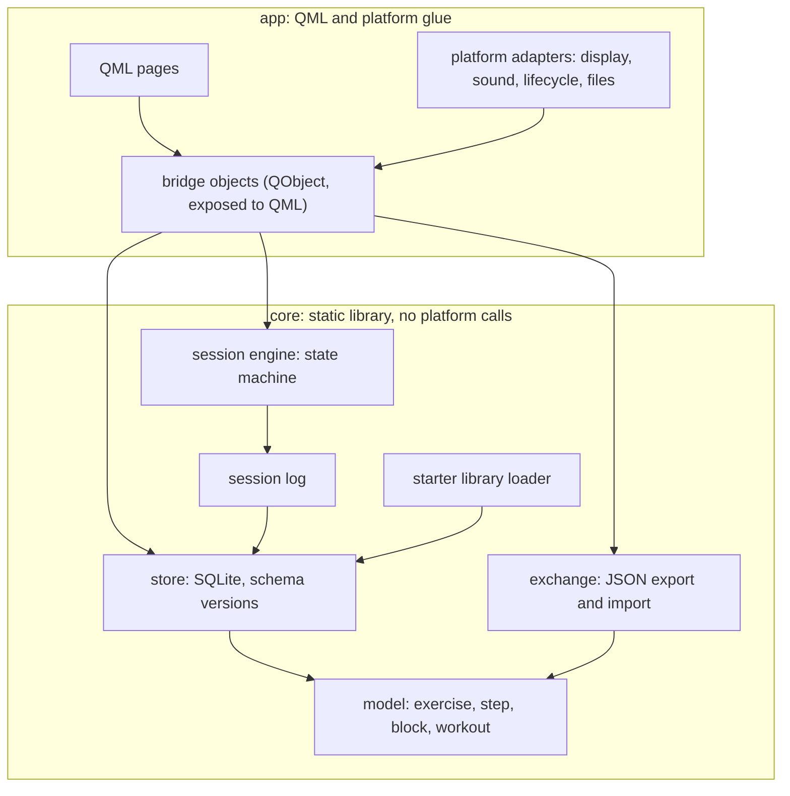
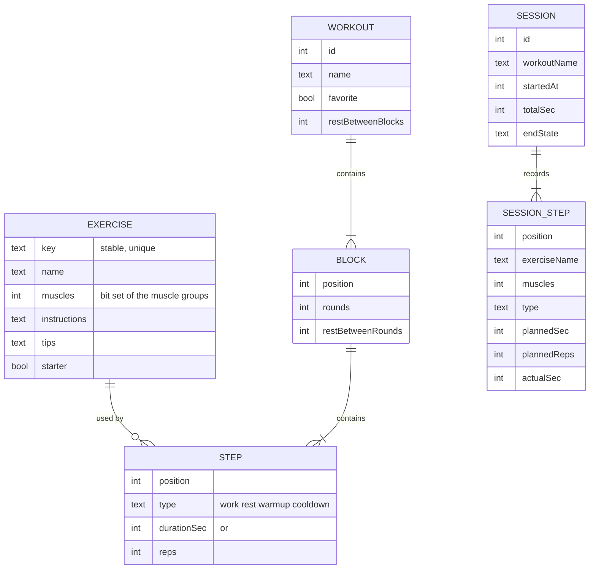
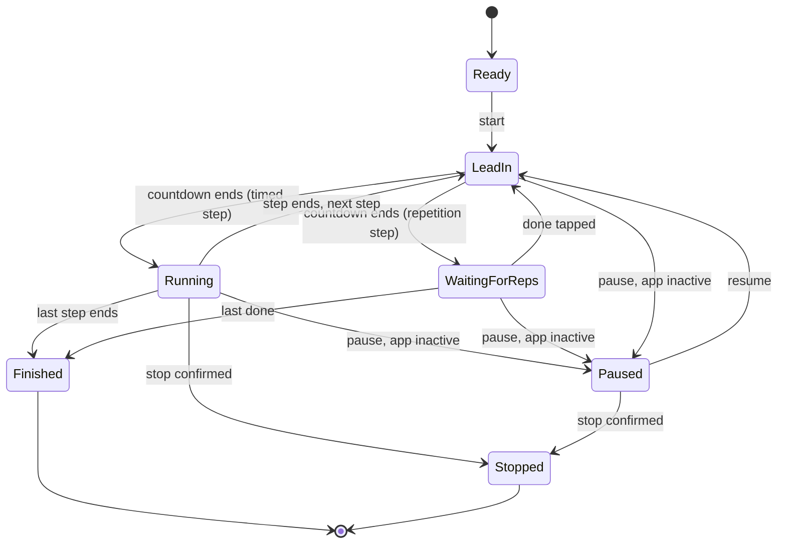

# Architecture

Workout Trainer is a Sailfish OS application (Qt 5, C++, QML with Silica) that runs in the Harbour sandbox. The logic lives in a static library without platform dependencies that is unit tested on the PC. The QML application is a thin layer on top of it. Requirement numbers (`R-...`) refer to [requirements.md](requirements.md).

## Modules



`core` talks to the platform only through small interfaces (`Clock`, a monotonic millisecond clock, and file or path providers), so tests can replace them.

## Data model



- A step is timed (`durationSec`) or repetition-based (`reps`), never both (R-WRK-4). A rest step has no exercise (R-WRK-3).
- The session log copies names and muscle groups, so it stays correct when exercises are edited or deleted (R-HST-1, R-HST-2). Repetitions and load actually done are not recorded.
- Starter exercises carry a stable `key`. A table of the starter keys already offered to the user prevents an upgrade from restoring an exercise the user deleted or overwriting one the user edited (R-EXR-6).

## Session engine

The engine receives a flat plan: the blocks of the workout expanded by their rounds, with the rests between rounds and blocks inserted (R-WRK-2, R-WRK-5). It never counts ticks: the remaining time of a step is computed from the monotonic clock, so a late timer callback does not accumulate error (R-TMR-5).



The engine emits events (step started, last-seconds tick, round changed, finished) that the bridge maps to sounds, optional vibration and the screen. Skip and back move to another step of the plan (R-TMR-4). Pausing and resuming freeze and restore the remaining time.

## Platform notes

Behavior verified on the platform, which the design relies on:

- **Display:** a `DisplayBlanking` object (`Nemo.KeepAlive 1.2`) must be instantiated with `preventBlanking` bound to "session in progress and app active". The prevention ends when the app goes to the background or is killed (R-TMR-7).
- **Lifecycle:** the pause trigger is `Qt.application.active`. Page visibility is not usable: the page stays visible under the lock screen, and removing a page from the stack changes no application state (R-TMR-8, R-TMR-9). After the display is switched on, the application becomes active again only after the unlock.
- **Sound:** `SoundEffect` from `QtMultimedia` plays short WAV files and needs the `Audio` permission (R-ALR-1).
- **Vibration:** only `ThemeEffect` from `QtFeedback 5.0` is accepted by the validator. The option is shown only if `supported` is true (R-ALR-4).
- **Files:** the `Documents` permission covers the export folder and the file pickers (`Sailfish.Pickers 1.0`). Export files are written with `QSaveFile` (R-IMP-1, R-IMP-2).
- **Storage:** one SQLite database through `QtSql` in `QStandardPaths::AppDataLocation`, writes in transactions, schema version in `PRAGMA user_version` with ordered migrations (R-HST-4, R-NFR-3). Settings use `Nemo.Configuration 1.0`.
- **Packaging:** no `Sandboxing` key in the desktop file, no scriptlets, license `GPLv3+` in the spec.

## Starter library and images

The starter exercises are a JSON file installed with the app (English text, kept apart from code, R-I18N-4). The muscle-group cue is an animated puppet figure drawn by the app from simple shapes (R-MUS-1); it needs no picture files.

## Project layout

```
core/      static library: model, engine, store, log, exchange, starter loader
app/       QML pages, bridge objects, platform adapters, desktop file, translations, icons
data/      muscle-group pictures, starter exercises, sounds
rpm/       spec file
tests/     QtTest programs for core
common.pri shared build settings (hostbuild switch, no installed test programs)
```

## Testing

- Host tests run with the SDK's i486 target and `CONFIG+=hostbuild`; they need no device. The engine is tested with a fake clock, the store with a temporary database, the exchange and the starter loader with sample files.
- Everything that needs the device (sound, vibration, display, lifecycle with a real call, file locations, power loss, timing and battery) is verified by hand on a phone.
